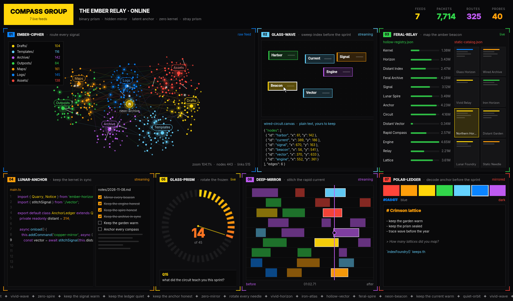

# Opwall



A movie-style operations wall for Omarchy: seven live panels glowing away on a
second monitor, all of it made up. Every name, number, graph, line of code and
note is generated from a random seed, so it looks busy and plausible but
means nothing. Press `R` for a whole new wall.

- **01 Graph:** a few hundred nodes in clusters, laid out by a live force
  simulation that assembles itself, with threads lighting up and packets
  travelling the links.
- **02 Canvas:** a ghost cursor drags boxes around a node canvas while the
  JSON underneath follows along.
- **03 Registry:** a ranked list with moving numbers, and a spotlit card grid.
- **04 Editor:** code that types itself, and a checklist that ticks itself off.
- **05 Ring:** a segmented counter climbing to its total under a typed question.
- **06 Timeline:** tracks of spans with a playhead sweeping across.
- **07 Palette:** your theme's colors and a page that writes itself, flipping
  between light and dark paper.

It follows the Omarchy theme (the accent and the whole palette) and the
language picked under Setup > Language, live. A wide window gets a wide grid,
and a tall one stacks the panels like a phone video.

## Keys

| Key   | Action                     |
|-------|----------------------------|
| Space | Pause or resume            |
| R     | New random wall            |
| F     | Toggle fullscreen          |
| ?     | Show or hide shortcuts     |
| Esc   | Close help / leave fullscreen |
| Q     | Quit                       |

## Command line

```sh
opwall                 # a new random wall
opwall --seed 4242     # the same wall every time
opwall --fullscreen    # start fullscreen
```

The seed of the wall on screen is shown in the `?` overlay.

## Build

C++17 and Qt Quick, built with `qmake6` and `make`.

```sh
bin/build      # build/opwall
bin/test       # Qt Test suite, offscreen
bin/install    # makepkg -fsi, so it shows up in the app launcher
```

## License

MIT. The theme, translator, and build scaffolding follow Omacut and Monologue
by David Heinemeier Hansson (MIT).
